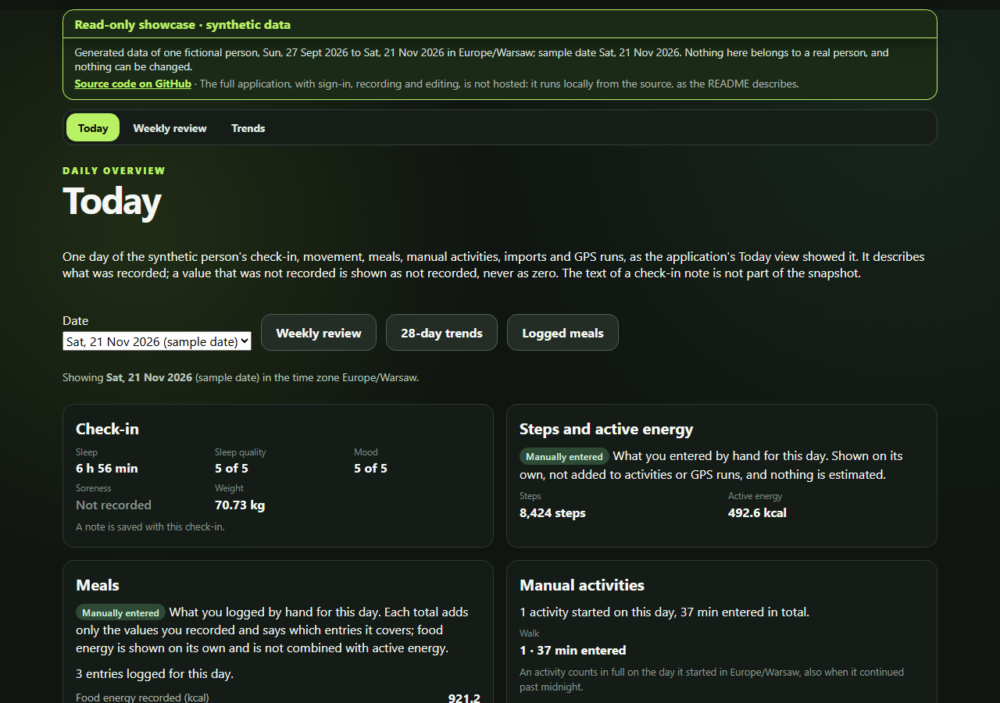
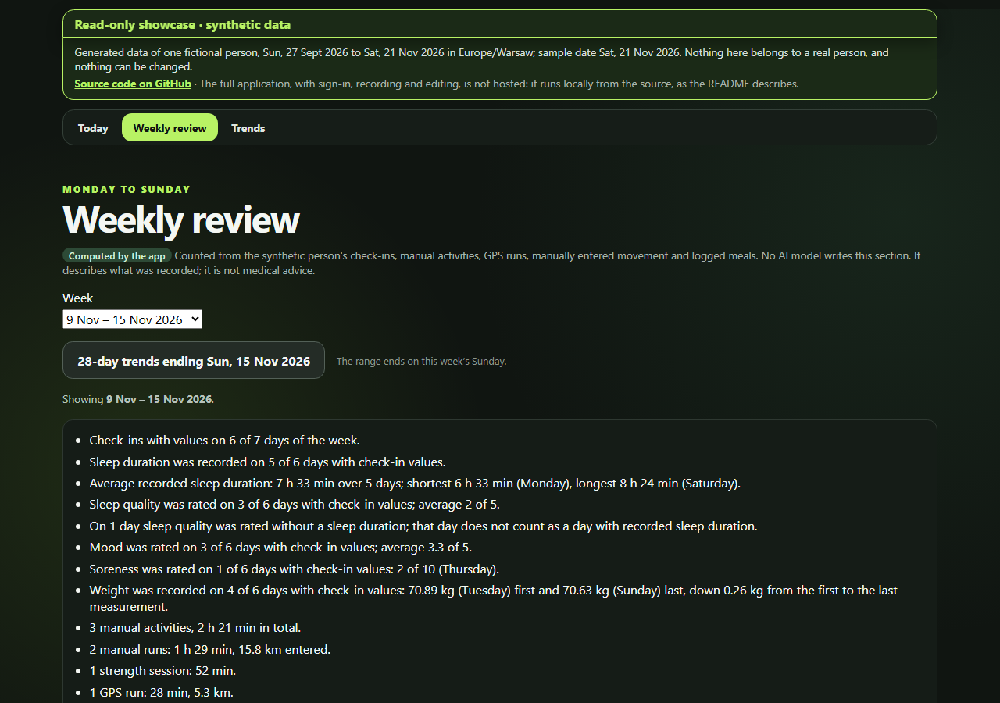
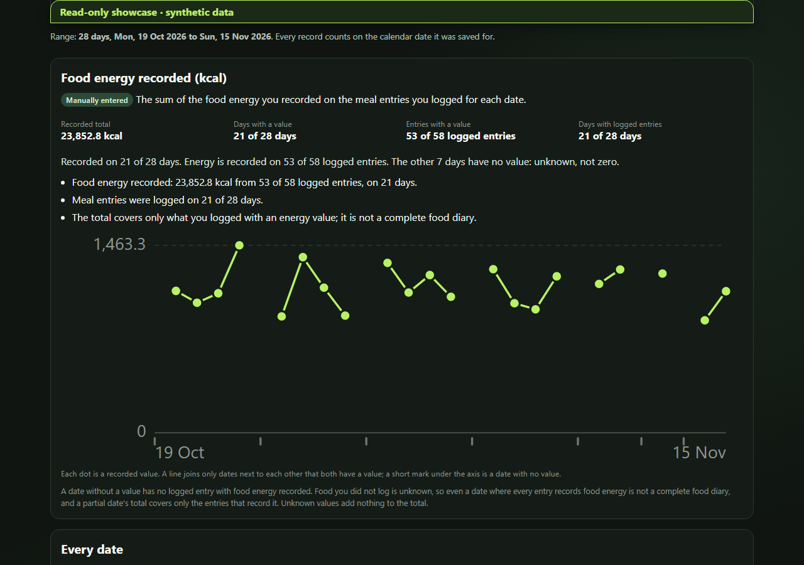
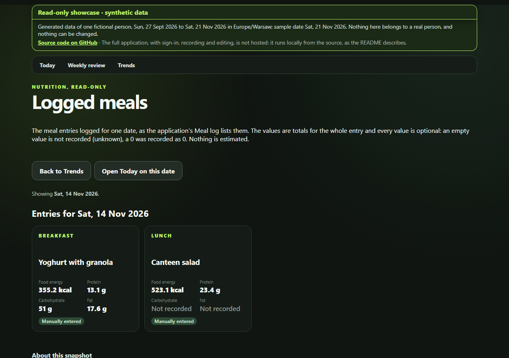

# SomaLane

[](https://github.com/AlexTikhon/SomaLane/actions/workflows/ci.yml)
[](LICENSE)

SomaLane is a personal activity, health and nutrition tracker with deterministic analytics. You keep a daily
check-in, movement, activities and a meal log, and record runs in the browser. One day appears on **Today**, one week
in a **Weekly review** and 28 days on **Trends**. Code computes every number, and a value nobody recorded is shown as
unknown, never as zero. AI features exist, but they are optional, experimental and off by default.

**Try the read-only showcase: <https://alextikhon.github.io/SomaLane/>**

The showcase is a static page of synthetic data with no sign-in, and nothing on it can be changed. The full
application, with sign-in, recording and editing, is not hosted: it runs locally from this repository
([below](#run-it-locally)).

## The primary journey

> daily records → **Today** → **Weekly review** → **Trends** → back to the original records

| | |
|---|---|
| [](docs/assets/screenshots/showcase-today.png) | [](docs/assets/screenshots/showcase-weekly-review.png) |
| **Today.** One day across every record, each value labelled with its source. Soreness was not recorded, so it says so. | **Weekly review.** Coverage and values for one Monday-to-Sunday week, worded by code. No model writes it. |
| [](docs/assets/screenshots/showcase-trends-food-energy.png) | [](docs/assets/screenshots/showcase-logged-meals.png) |
| **Trends.** 28 dates with coverage: "the other 7 days have no value: unknown, not zero". The line breaks where nothing was recorded. | **Logged meals.** A Trends date opens its entries. An empty value is unknown; a recorded 0 stays 0. |

Screenshots of the live showcase (desktop, 1280 × 900), captured on 2026-11-24 from the deployment of `3bbe2b2`.
All data is synthetic: one fictional person over 56 dates.

## What it does

- **Daily records** (owner-only; a coach never sees them): a check-in (weight, sleep, mood, soreness, a note), manual
  steps and active energy, manual activities, one GPX 1.1 track or one TCX v2 activity imported after a preview, and a
  meal log with optional energy and macronutrients. Nothing is estimated or looked up.
- **Views**: Today, Weekly review and Trends (weight, sleep, steps, food energy and macronutrients, each with its own
  coverage, plus an activity comparison with the previous 28 days). Every view links back to its records.
- **Runs** (the engineering demonstration): record a run from a GPS simulator or desktop Geolocation; it survives going
  offline and reloads. Share it with a coach who watches it live over Server-Sent Events, then keep it in a
  revision-safe archive of vector tiles.
- **Optional AI, off by default**: a meal draft from text, Ask my data interpretation, weekly insights and run search
  in words. None has valid passing model evidence for the current code
  ([status](docs/portfolio-v1-release-plan.md#21-ai-evaluation-status)). The deterministic paths, including Ask my
  data's guided questions, need no model.

Product principles and the roadmap: [docs/product-direction.md](docs/product-direction.md).

## Architecture

```text
 GitHub Pages ── static showcase: content blocks + one synthetic snapshot JSON (no API, no sign-in, no storage)

 Browser (React 19, Vite) ── IndexedDB: offline point buffer, pending commands, writer lease
        │  local default: HTTP on 127.0.0.1:5173, Vite proxies /api to the API
        │  HTTPS only through nginx in the configured production, loopback-TLS and iPhone pilot profiles
        ▼
 API (Node 24, Express 5) ── sessions in PostgreSQL, CSRF + exact Origin checks, read models, SSE live board,
        │                    maintenance jobs (summaries, auto-finish, retention, journal export)
        ▼
 PostgreSQL 17 + PostGIS 3.5 ── row-level security per person and organization, migration-owned schema,
                                separate runtime / migration / maintenance roles
```

The engineering decisions most worth reviewing (explained with failure scenarios, code and tests in
[docs/interview.md](docs/interview.md)):

- **Missing is not zero.** Totals and coverage come from SQL in one `REPEATABLE READ READ ONLY` snapshot. Each
  nutrient keeps its own count of recorded entries and days, a sum is `NULL` when nothing was recorded, and the
  response contract checks that the range equals the sum of its dates (ADR-0084, ADR-0096). The weekly review is
  sentences written by code with explicit denominators (ADR-0077).
- **Row-level security is the isolation boundary.** The API connects as a non-owner role without `BYPASSRLS`. Tenant
  context is transaction-local, and health records are owner-only. A load measurement found the per-row policy was the
  bottleneck, and set-based policies removed it (ADR-0003, ADR-0042).
- **At-least-once delivery, idempotent persistence.** Points go to IndexedDB first and are retried. The server stores
  each `(run, seq)` once and refuses a changed payload with `409`. One tab writes at a time, fenced by a durable epoch
  checked inside every write (ADR-0009, ADR-0010, ADR-0053).
- **Revision-bound everything.** Summaries, live-track pages and archive tiles are bound to a revision, so stale work
  is rejected instead of published (ADR-0015, ADR-0030).
- **Restores replay what was exported after the backup.** Deletions, revoked access and erasures of health records
  are journaled in the same transaction as the change. A job exports them as files to `DELETION_JOURNAL_DIR`, and a
  restore replays the exported journals (ADR-0037, ADR-0045, ADR-0073). A change that was not exported before the host
  was lost can reappear after a restore: the window is one export interval plus any backlog
  ([recovery limits](docs/runbooks/deletion-journal-and-recovery.md#failure-modes-and-honest-limits)). The
  application cannot check where that directory lives, so off-host storage must be configured by the operator. This
  is verified by a local drill and in CI on throwaway databases, not on a host.
- **A tested showcase boundary.** The public site is a separate static build, published by a manual, least-privilege
  workflow (ADR-0099, ADR-0101).
  - A module-graph test keeps its code away from the API client, sign-in, browser storage and capture.
  - Its snapshot is an allowlist of synthetic data validated by the shared contracts.
  - Before every publication, its browser check fails on any request to `/api`, outside `/SomaLane/` or to another
    origin, and on any attempt to write cookies, Web Storage, IndexedDB, Cache Storage or a service worker.
  - The same request and storage checks passed against the live site.

| Path | What it is |
|---|---|
| `apps/api` | Express 5 API, maintenance jobs, backup/restore and evaluation CLIs |
| `apps/web` | React web app (Vite) and the static showcase build (`apps/web/src/showcase`) |
| `packages/contracts` | Zod schemas shared by API and web; generates `openapi/openapi.json` |
| `packages/fixtures`, `tools/simulator` | deterministic test data and a GPS simulator |
| `db/migrations` | SQL migrations, checksummed and applied in order |
| `infra/`, `scripts/` | Compose files, nginx proxy, setup, demo and profile verification |
| `tests/e2e` | Playwright suites (Chromium with OpenID Connect, Firefox and WebKit gates, showcase) |
| `docs/` | release plan, design, decision records, runbooks, reports and the progress log |

## Run it locally

Requirements: Node.js 24 (`>=24.11.0 <25`), npm 11, and Docker with Compose v2. Use synthetic data only: local
sign-in uses fixed demo people.

```powershell
npm ci
npm run demo:doctor   # read-only: is this machine ready?
npm run demo:up       # database, migrations, demo people, API and web app; Ctrl+C stops them
```

Open <http://127.0.0.1:5173> and press **Demo runner** or **Demo coach**.

| To… | Run | Runbook |
|---|---|---|
| Rehearse the run, offline, sharing and archive demo | `npm run demo:up` | [demo.md](docs/runbooks/demo.md) |
| See Today, the Weekly review and Trends on populated data | `npm run portfolio:dataset` (its own database, never the dev one) | [portfolio-dataset.md](docs/runbooks/portfolio-dataset.md) |
| Build and preview the showcase | `npm run build:showcase`, `npm run preview:showcase` | [showcase.md](docs/runbooks/showcase.md) |
| Set up for development without the demo command | copy `.env.example` to `.env`, then `db:up`, `db:bootstrap`, `db:migrate` and `npm run dev` | [reference.md](docs/reference.md#start-from-a-clean-checkout) |
| Try the iPhone LAN pilot (synthetic data; physical checks not run) | `npm run pilot:configure` … `pilot:verify` | [iphone-lan-pilot.md](docs/runbooks/iphone-lan-pilot.md) |

Operating runbooks (not exercised on any host): [sign-in](docs/runbooks/identity-provider.md),
[deployment](docs/runbooks/deployment.md), [backup and restore](docs/runbooks/backup-and-restore.md) and the
[deletion journal](docs/runbooks/deletion-journal-and-recovery.md).

## Verification

- **CI** ([ci.yml](.github/workflows/ci.yml)) runs on every push to `main` and on pull requests: lint, typecheck, unit
  tests and build (`npm run verify`); the API against real PostgreSQL/PostGIS as the real database roles, restore drill
  included (`npm run test:integration`); Playwright in Chromium with an OpenID Connect provider process; a Firefox core
  gate; and a bounded WebKit gate. It reads no secrets and deploys nothing. The latest checked run,
  [45385170103](https://github.com/AlexTikhon/SomaLane/actions/runs/45385170103) for `3bbe2b2`, succeeded on
  2026-11-24.
- **The showcase** is published only by the manual [Pages workflow](.github/workflows/showcase-pages.yml). It reruns
  the showcase's unit and browser checks first, under `/SomaLane/`, with a guard that fails any API request or storage
  write. The live site was then checked in desktop Chromium and Firefox automation: status codes, the snapshot digest,
  the journey, four same-origin requests and no storage
  ([step-8 report](docs/reports/showcase-hosted-verification-2026-11-24.md)).
- Every public claim and the evidence it needs:
  [release plan, section 5](docs/portfolio-v1-release-plan.md#5-capability-claims-and-the-evidence-each-needs). Each
  verification, entry by entry: [docs/progress.md](docs/progress.md).

## Limitations

- **Only the static showcase is published.** The full application is a local demonstration. It is not deployed
  anywhere, its production profile is verified on a workstation only, and no production recovery point or time is
  claimed.
- **Sign-in** was tested only against a test OpenID Connect provider, never a real one.
- **Backup and restore** were verified by a local drill and in CI on throwaway databases. No host's backup has been
  restored.
- **Desktop-scoped.** Nothing has run in Safari or on a phone: Playwright WebKit is automation, not Safari, and the
  iPhone pilot's physical checks are not run. Capture is foreground only, and real-device GPS accuracy is not analysed.
- **No real Mapbox basemap** was rendered in any test, and no AI feature has valid passing model evidence.
- **One API process.** Sessions are shared through PostgreSQL, but the live hub, tile cache, admission limits and
  maintenance runners are per process. Load figures come from one workstation.
- GPX and TCX import cover one documented subset each. There is no FIT import, HealthKit or phone/watch import.

Hosting the full application, a real identity provider and a hosted restore are deferred beyond portfolio v1
([release plan, 6.1](docs/portfolio-v1-release-plan.md#61-deferred-by-the-scope-change-of-2026-11-24)).

## Project status

Portfolio v1 is in preparation. Feature work is paused for a ten-step release plan,
[docs/portfolio-v1-release-plan.md](docs/portfolio-v1-release-plan.md), which holds the scope, gates and status.
Steps 1–9 are done; step 10 (final verification, tag and freeze) is next. No release has been tagged yet. Milestones
so far are summarised in [CHANGELOG.md](CHANGELOG.md).

The project started as **Running Tracker**. Package names, database identifiers, cookies and environment variables
keep the `running-tracker` names; only the product and the visible app are called SomaLane.

## Documentation

| Document | Use it for |
|---|---|
| [docs/interview.md](docs/interview.md) | the pitch, architecture, engineering stories and a walkthrough |
| [docs/portfolio-v1-release-plan.md](docs/portfolio-v1-release-plan.md) | release scope, steps, gates, evidence per claim, deferrals |
| [docs/reference.md](docs/reference.md) | API behaviour, data rules, configuration and verification for every feature |
| [docs/SDD.md](docs/SDD.md) | the original system design |
| [docs/adr/](docs/adr/) | one decision record per slice |
| [docs/runbooks/](docs/runbooks/) | how to run, demo, publish, deploy, back up and pilot it |
| [docs/reports/](docs/reports/) | measurements, reviews and verification reports |
| [packages/contracts/openapi/openapi.json](packages/contracts/openapi/openapi.json) | the HTTP API (OpenAPI 3.1); SSE in [packages/contracts/sse.md](packages/contracts/sse.md) |

## Licence

[MIT](LICENSE). Copyright (c) 2026 Alex Tikhon.
