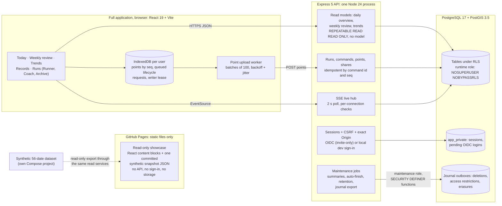

# SomaLane: interview package

Notes to speak from in a technical interview about SomaLane, with links to the code, the tests and the evidence. It is
written for the project as it stands at portfolio v1 release step 9 (2026-11-24). What counts as evidence, and which
claims need which evidence, is defined in the [release plan](portfolio-v1-release-plan.md#2-evidence-vocabulary). This
document does not add claims of its own.

SomaLane is a learning project built by one person. It has no production users, no production incidents and no hosted
application. Where this document says "measured", it names the workload, the machine and what the number covers.

Contents: [pitch](#the-pitch-6090-seconds) · [architecture](#architecture) ·
[delivery semantics](#delivery-semantics-in-one-paragraph) · stories
[1](#1-deterministic-analytics-missing-is-not-zero) [2](#2-postgresql-row-level-security-as-the-isolation-boundary)
[3](#3-offline-recovery-idempotent-persistence-and-writer-fencing) ·
[more depth](#more-depth-if-asked-live-streams-archive-revisions-and-restore) ·
[follow-up questions](#likely-follow-up-questions) · [public showcase walkthrough](#public-showcase-walkthrough-23-minutes) ·
[local engineering demo](#local-engineering-demo-57-minutes) · [scaling](#scaling-boundaries) ·
[optional AI](#optional-ai-status) · [not established](#what-is-not-established)

## The pitch (60–90 seconds)

> SomaLane is a personal activity, health and nutrition tracker I built end to end. You keep a daily check-in,
> movement, activities and a meal log, record runs in the browser, and see one day on **Today**, one week in a
> **Weekly review** and 28 days on **Trends**. Each view leads back to the records it was computed from.
>
> The rule I designed around is that code computes every number, and a value nobody recorded is shown as unknown,
> never as zero. The totals, coverage and trends come from SQL in one read-only snapshot, and the weekly review's
> sentences are written by code. A model is optional and off by default: it may only propose something, and the person
> confirms it.
>
> Underneath it's React and an Express 5 API on PostgreSQL with PostGIS. Isolation between people and organizations is
> enforced by row-level security under a non-owner database role, not by `WHERE` clauses I might forget. Run recording
> is built for failure: points go to IndexedDB first, uploads are retried, the server makes repeats harmless by key,
> and only one tab can write, enforced by a fencing token.
>
> You can click through a read-only showcase of synthetic data on GitHub Pages. The full application runs locally,
> and CI runs unit, real-PostgreSQL integration and browser suites on every push. What it doesn't have is a hosted
> deployment, a real identity provider or any phone testing, and I'm explicit about that.

About 220 words, roughly 80 seconds. For 60 seconds, drop the third paragraph's last sentence and shorten the
last paragraph to its first sentence.

## Architecture

What is where:

- **Composition root.** [main.ts](../apps/api/src/main.ts) builds the two database pools (runtime and maintenance), the
  PostgreSQL session and pending-login stores, the SSE hub and the periodic maintenance runners.
  [app.ts](../apps/api/src/app.ts) mounts the routes. Locally, Vite proxies `/api` ([vite config](../apps/web/vite.config.ts)).
  The production profile puts nginx in front ([ADR-0043](adr/0043-single-host-deployment-profile.md)); it is verified
  on a workstation and not deployed anywhere.
- **Three database roles**, all `NOSUPERUSER NOBYPASSRLS` ([bootstrap-database.mjs](../scripts/bootstrap-database.mjs),
  [ADR-0003](adr/0003-p02a-database-boundary.md)): the owner runs migrations; the runtime role is the API's login and
  owns no table; the maintenance role has no table DML and only executes named `SECURITY DEFINER` functions.
- **Read models.** [Daily overview](../apps/api/src/daily-overview/daily-overview-service.ts) (Today),
  [weekly review](../apps/api/src/insights/weekly-review-service.ts) and
  [28-day trends](../apps/api/src/daily-trends/daily-trends-service.ts) are computed on every read and never stored.
- **The showcase boundary** ([ADR-0099](adr/0099-public-read-only-showcase.md),
  [ADR-0101](adr/0101-github-pages-showcase-publication.md)). The public site is a separate static build
  (`npm run build:showcase`) that renders the application's pure content blocks from one committed snapshot file,
  [showcase-snapshot.json](../apps/web/showcase/public/showcase-snapshot.json). That file is exported read-only from the
  synthetic dataset through the same read services the API uses
  ([showcase-export.ts](../apps/api/src/portfolio-dataset/showcase-export.ts)) and validated by the shared contracts
  ([showcase-snapshot.ts](../packages/contracts/src/showcase-snapshot.ts)). A module-graph test keeps the showcase away
  from App, controllers, the API client, sign-in, storage, capture and the writer lease, and keeps it out of the
  application's bundle ([showcase-boundary.spec.ts](../apps/web/src/showcase/showcase-boundary.spec.ts)). It is
  published only by a manual, least-privilege workflow ([showcase-pages.yml](../.github/workflows/showcase-pages.yml)).
- Two read endpoints named in the SDD (`/archive/runs`, `/live/nearby`) were never built. The OpenAPI document flags
  them `x-implemented: false`.

## Delivery semantics in one paragraph

Say this before story 3, and before any question about "exactly once". **The network gives at-least-once delivery at
best.** The browser retries a batch until it gets an answer that accounts for every point, so the server can receive
the same batch several times, for example when the commit succeeded but the response was lost. **Persistence is
idempotent.** A point is keyed by `(org_id, run_id, seq)`. An exact repeat is acknowledged as a duplicate without a
write, and the same `seq` with a different payload is refused with `409 POINT_CONFLICT`. Lifecycle commands work the
same way with a client-chosen command id. As a result, each point is *stored* once. That is not exactly-once delivery,
and nothing here claims it: delivery can repeat, and points that never leave the browser (cleared site data, a lost
device) are lost. The E2E tests named "delivered exactly once" assert that each sequence number exists once on the
server after retries, which is this property.

## Three stories

Each story has the same parts: what fails, what the code does, what it costs, the evidence and the limits.

### 1. Deterministic analytics: missing is not zero

**Failure scenario.** Someone logs two meals with an energy value and a third without one, and logs nothing at all on
four days of the month. A naive `SUM` over a left join reports those four days as 0 kcal, which drags every average
down. It presents a partial day as the day's intake, and it lets a chart draw a line through days nobody recorded. A
model asked to "summarise the week" can make it worse by inventing a number that sounds plausible.

**Implementation.**

- [daily-trends-service.ts](../apps/api/src/daily-trends/daily-trends-service.ts) runs one `REPEATABLE READ READ ONLY`
  transaction: the membership check plus a fixed number of range statements (check-ins, manual movement, meals), never
  one query per date or per nutrient. Every statement names the organization and the owner and runs under RLS.
- The meal statement uses `GROUP BY GROUPING SETS ((local_date), ())`: one row per date with an entry, plus exactly one
  row for the whole range. For each nutrient independently it selects `count(col)` (entries holding a value, a recorded
  0 included), the distinct dates holding one, and `sum(col)` in `numeric`. The sum is `NULL` when no entry has a
  value. [meal-nutrition-summary.ts](../apps/api/src/meals/meal-nutrition-summary.ts) parses those sums into integer
  tenths and throws on anything else, so a defect is never rounded into a plausible number.
- A date with no row gets every metric `null` with 0 recorded entries ("Not recorded"). A logged 0 stays 0 ("0 kcal").
  The response contract checks itself: a metric cannot be recorded for more entries than were logged, and the range
  totals must equal the sum of the dates ([daily-trends.ts](../packages/contracts/src/daily-trends.ts)).
- The [weekly review](../apps/api/src/insights/weekly-review.ts) is sentences written by code from the week's
  aggregate, with explicit denominators ("Sleep duration was recorded on 5 of 6 days with check-in values"). Manual and
  GPS runs are never added together, a single measurement never produces a "change", and no sentence judges or advises
  ([ADR-0077](adr/0077-deterministic-weekly-review.md), [ADR-0093](adr/0093-weekly-review-meal-nutrition.md)).
- The weekly review service imports no model provider, so it cannot call one.

**Trade-off.** The views are wordier than a dashboard: every figure carries its coverage ("21 of 28 days", "53 of 58
logged entries"). Reads are recomputed every time and nothing is cached, which is cheap at one person's 28 days but
would need measuring at another scale. Only manual entries are aggregated, so a later importer has to be added
deliberately rather than summed in by accident.

**Evidence.**

- Unit: [daily-trends.spec.ts](../apps/api/src/daily-trends/daily-trends.spec.ts),
  [weekly-review.spec.ts](../apps/api/src/insights/weekly-review.spec.ts) and the contract tests in
  [daily-trends.spec.ts](../packages/contracts/src/daily-trends.spec.ts).
- Real PostgreSQL: [daily-trends-http.integration.test.ts](../apps/api/test/daily-trends-http.integration.test.ts) and
  [daily-trends-meals-explain.integration.test.ts](../apps/api/test/daily-trends-meals-explain.integration.test.ts),
  which checks with `EXPLAIN` that the range is one bounded scan returning at most 29 rows.
- Browser: [trends-nutrition.spec.ts](../tests/e2e/trends-nutrition.spec.ts) (zero, missing and partial states, and
  the drill-down round trip).
- On the published showcase, the browser check asserts that 29 Oct is "Not recorded" and that the coffee of 21 Nov is
  "0 kcal" ([showcase.spec.ts](../tests/e2e/showcase/showcase.spec.ts)).
- Decision records: [ADR-0084](adr/0084-daily-trends.md), [ADR-0096](adr/0096-nutrition-trends-v2.md).

**Limits.** Records belong to their stored local date; a profile time zone does not exist (deferred). Two devices
editing the same day overwrite each other. "Recorded" means what the person typed: nothing is estimated, looked up
or validated against reality.

### 2. PostgreSQL row-level security as the isolation boundary

**Failure scenario.** One missing `AND org_id = $1`, or a coach endpoint that forgets to check the share, and a person
reads another organization's runs or someone's meal log. Separately, a pooled connection that keeps the previous
request's user id would leak one request's identity into the next.

**Implementation.**

- [tenant-transaction.ts](../apps/api/src/database/tenant-transaction.ts) checks out one client, opens a transaction
  and sets `app.user_id` and `app.org_id` with `set_config(..., true)`. That setting is transaction-local, so the
  context ends with `COMMIT` or `ROLLBACK` and cannot leak through the pool. A transport error during commit is
  reported as an unknown outcome and the connection is destroyed.
- [authenticated-tenant-transaction.ts](../apps/api/src/database/authenticated-tenant-transaction.ts) takes the user
  only from the verified server-side session and rechecks active membership inside the same transaction.
- Policies decide visibility. A run is visible to its owner, and shared runs need `can_read_live` or
  `can_read_history` ([0002](../db/migrations/0002_runs_shares_rls.sql),
  [0003](../db/migrations/0003_run_points_summaries_rls.sql)). Health records are **owner-only**: a run share never
  grants check-ins, movement, activities or meals ([0039_meals.sql](../db/migrations/0039_meals.sql) has select,
  insert, update and delete policies for the owner only).
- Every runtime connection has PostgreSQL-enforced budgets: `statement_timeout` 5 s and `lock_timeout` 2 s by default,
  mapped to a retryable 503 ([ADR-0050](adr/0050-runtime-sql-budgets.md)).

**Trade-off, with a measured cost.** The P11 load measurement found that RLS was nearly all of the database time of
the hot reads: the first policies called a definer function per row. Set-returning functions now compute the readable
`(org_id, run_id)` pairs once per statement ([0019](../db/migrations/0019_set_based_run_visibility.sql),
[ADR-0042](adr/0042-set-based-run-visibility.md)). On the same EXPLAIN catalogue (SDD-sized organization: 10 members,
3,650 runs; stress: 3 million raw points; one workstation; database execution time only), a z11 archive tile went from
360 to 56 ms and the first live-track page of a 42,857-point run from 2,058 to 39 ms. The cheap live poll got slower
(2 → 24 ms), so the live hub declares a narrowing `visibilityScope: 'live'`, which can only remove rows
([p11-measurements.md](reports/p11-measurements.md), [p11-5-measurements-after.md](reports/p11-5-measurements-after.md);
recorded 2026-09-30).

**Evidence.** Integration tests run their security assertions as the runtime role, not as a superuser.
[rls-set-policies.integration.test.ts](../apps/api/test/rls-set-policies.integration.test.ts) compares the set
functions with the per-row specification for every fixture identity.
[meals-access.integration.test.ts](../apps/api/test/meals-access.integration.test.ts) shows nothing to a grantee, a
coach, another organization, an inactive member or a malformed context. The integration suite runs in hosted CI on
every push to `main` (latest checked: [run 45385170103](https://github.com/AlexTikhon/SomaLane/actions/runs/45385170103)
for `3bbe2b2`, success, 2026-11-24).

**Limits.** The tables do not use `FORCE ROW LEVEL SECURITY`, so the owner role bypasses RLS. That is why the API must
never hold owner credentials; the seeder and restore tools that do are separate commands. A session variable is not a
boundary against someone who already holds runtime credentials and can run arbitrary SQL. The equivalence of the set
policies is proven for the fixture matrix, not for every possible state, and the hashed set does not spill, so a much
larger organization would need another shape.

### 3. Offline recovery, idempotent persistence and writer fencing

**Failure scenario.** The runner loses signal for a minute, the tab may be reloaded, and when the network returns the
first upload commits on the server but the response is lost. Meanwhile a second tab is open, or a frozen background
tab wakes up after a reload. A naive client drops points, duplicates them, or lets two writers hand out the same `seq`
for different points.

**Implementation.**

- **Durable first.** Capture writes each point to IndexedDB in a transaction that also allocates its `seq`
  ([runner-storage.ts](../apps/web/src/runner-storage.ts), [ADR-0008](adr/0008-indexeddb-runner-buffer.md)).
- **Retry blindly, delete exactly.** [point-upload-worker.ts](../apps/web/src/point-upload-worker.ts) sends at most 100
  points in `seq` order. It deletes exactly those sequence numbers, and only when `insertedCount + duplicateCount`
  equals the batch size. Network errors and 408/425/429/5xx keep the batch and retry with capped exponential backoff
  and full jitter (1 s base, 30 s cap), honouring `Retry-After`. Other 4xx answers stop that run's worker and keep its
  points for the person to export or discard ([ADR-0009](adr/0009-point-upload-worker.md),
  [ADR-0048](adr/0048-runner-review-recovery.md)).
- **Idempotent on the server.** [`ingestRunPoints`](../apps/api/src/runs/run-service.ts) locks the run row
  (`FOR UPDATE`) and compares every repeated `seq` with its canonical stored payload. It inserts only new points and
  bumps `data_revision` once per batch that added anything. Lifecycle commands carry a `commandId` and an expected
  revision; the stored response is replayed for a repeat. Runs are created with `PUT` and a client-generated id. A
  deleted id answers `410 RUN_DELETED` for a year ([ADR-0036](adr/0036-tombstone-lifetime-and-late-retry-contract.md)).
- **One writer per browser profile.** A lease record in IndexedDB holds an owner, a 15 s renewable expiry and a
  `fencingToken` ([writer-lease.ts](../apps/web/src/writer-lease.ts), [ADR-0010](adr/0010-browser-writer-lease.md)).
  The token is a durable epoch: release marks the record released and never deletes it. Before that, release plus a
  new acquire reissued token 1, an ABA bug I reproduced and fixed
  ([ADR-0053](adr/0053-monotonic-writer-lease-fencing-epoch.md)).
- **The fence is inside each write.** Appending a point, queueing or acknowledging a lifecycle request, storing a
  server answer and clearing a finished run all re-read the lease in the same IndexedDB transaction and refuse on a
  mismatch ([ADR-0055](adr/0055-scoped-writer-fenced-run-authority.md),
  [ADR-0059](adr/0059-writer-fenced-lifecycle-requests.md), [ADR-0060](adr/0060-writer-fenced-finished-run-clear.md)).
- **A reload doesn't wait 15 s.** Each tab holds a Web Lock named after its owner id, and a claimant replaces a live
  lease only once that lock proves the holder is gone ([writer-presence.ts](../apps/web/src/writer-presence.ts),
  [ADR-0047](adr/0047-reload-writer-recovery-and-capture-source.md)).
- App, not a screen, owns capture, uploads and the lease. Switching to Today or the Weekly review, or reloading on
  Today, does not stop a recording ([ADR-0097](adr/0097-navigation-and-first-use-flow.md)).

**Trade-off.** Correctness lives on the server, so the client can stay simple and retry. The costs are a
canonicalisation step (millisecond time, `-0`, bigint as a decimal string) so that "the same point" has one meaning, a
read of existing rows before each insert, and a row lock that serializes batches of one run. The lease is
browser-local, so it needs no round trip and works offline, but it fences tabs of one profile only. Across devices the
server's rules take over: one active run per user (a unique partial index), command revisions, and `POINT_CONFLICT`
on a reused `seq`, which halts the upload visibly rather than merging.

**Evidence.**

- [point-ingestion.integration.test.ts](../apps/api/test/point-ingestion.integration.test.ts) drops the response after
  a real `COMMIT`. It uses a test-only hook, [fault-injection.ts](../apps/api/src/testing/fault-injection.ts), which is
  refused outside `APP_ENV=test`. The test sees `ECONNRESET`, checks the rows in SQL, retries and gets duplicates only.
- [writer-lease-epoch.spec.ts](../apps/web/src/writer-lease-epoch.spec.ts): overlapping transactions on fake-indexeddb;
  stale renew, release, append and discard are refused, and concurrent acquires produce one winner.
- Browser: [reload-offline.spec.ts](../tests/e2e/reload-offline.spec.ts), [second-tab.spec.ts](../tests/e2e/second-tab.spec.ts),
  [runner-recovery.spec.ts](../tests/e2e/runner-recovery.spec.ts),
  [lifecycle-takeover.spec.ts](../tests/e2e/lifecycle-takeover.spec.ts) and
  [primary-journey.spec.ts](../tests/e2e/primary-journey.spec.ts) (capture and upload continue while Today and the
  Weekly review are shown). The Firefox core gate repeats the reload, offline and second-tab cases.
- Load scenario P11.3 sent exact and overlapping retries of 100-point batches with no unexpected responses
  ([p11-5-measurements-after.md](reports/p11-5-measurements-after.md)).

**Limits.** The buffer is one browser's storage: clearing site data or losing the device loses unsent points. Capture
is foreground only and was driven by the Simulator or desktop Geolocation, never a phone. Offline tests use
Playwright's network emulation, not a real radio. There is no server-side writer lease, and the "duplicate tab" in the
tests is modelled by copying sessionStorage.

## More depth, if asked: live streams, archive revisions and restore

Short answers, each with where to read more.

- **SSE with revalidation** ([live-sse.ts](../apps/api/src/live/live-sse.ts),
  [ADR-0022](adr/0022-bounded-shared-sse-transport.md), [ADR-0023](adr/0023-live-stream-authorization-revalidation.md)).
  The initial state is read before the stream opens, and the database client is released, so an open stream holds no
  connection. One scheduler polls every 2 s, grouped by user and organization. Each cycle checks every distinct open
  session against the PostgreSQL store and fails closed. Membership loss closes the stream; grant loss sends a complete
  state without the run. Bounded: 64 connections, poll concurrency 2, and a writer blocked for 10 s is closed.
  Revocation is eventual: about one poll plus one short transaction. Bytes already delivered cannot be recalled.
  Measured on one workstation with 10 observers (P11.5): fresh point to SSE event p95 about 2 s, which is the poll
  interval. Tests: [live-sse.spec.ts](../apps/api/src/live/live-sse.spec.ts),
  [live-state.integration.test.ts](../apps/api/test/live-state.integration.test.ts),
  [run-sharing.spec.ts](../tests/e2e/run-sharing.spec.ts).
- **Revision-bound summaries, live tracks and archive tiles** ([ADR-0013](adr/0013-revision-bound-summary-calculation.md),
  [ADR-0015](adr/0015-revision-checked-summary-publication.md), [ADR-0030](adr/0030-atomic-archive-cache-invalidation.md),
  [ADR-0032](adr/0032-bounded-archive-tile-generation.md)). A summary is computed for a fixed `source_revision` and
  published only if the run still has exactly that revision
  ([run-summary-publication.ts](../apps/api/src/maintenance/run-summary-publication.ts)). Tile URLs carry the
  organization's archive revision; a stale URL answers `409 ARCHIVE_REVISION_CHANGED`, and the cache key includes the
  revision and the user ([archive-tile-cache.ts](../apps/api/src/archive/archive-tile-cache.ts)). Invalidation cannot
  race because a new revision is a new key. The cost is coarseness: any archive-visible change invalidates the whole
  organization's tiles.
- **Backup, restore and replaying what happened after the backup** ([ADR-0044](adr/0044-backup-restore-drill.md),
  [ADR-0037](adr/0037-durable-deletion-journal.md), [ADR-0045](adr/0045-access-restriction-journal.md),
  [ADR-0073](adr/0073-erasure-ledger-and-idempotent-activity-creation.md)). Deletions, access restrictions and
  erasures of health records are journaled in the same transaction as the change. A job exports them as files to
  `DELETION_JOURNAL_DIR` and deletes the rows only after the file is fsynced. The application cannot check where that
  directory lives, so putting it on off-host storage is the operator's job. The recovery order is: restore, migrate,
  `restore:reapply-deletions`, `restore:reapply-access`, `restore:reapply-erasures`, `restore:clear-sessions`, then an
  explicit `GRANT CONNECT` ([runbook](runbooks/deletion-journal-and-recovery.md#restore-procedure-ordered)). The access
  replay can only remove access, never grant it. **Evidence is local only.** The drill runs against throwaway databases
  on the workstation ([p12-4-restore-drill.md](reports/p12-4-restore-drill.md), 2026-10-01: 30 checks; a 3.4 s RTO on a
  15.9 MiB database that says nothing about production) and inside CI's integration job
  ([backup-restore.integration.test.ts](../apps/api/test/backup-restore.integration.test.ts)). No backup taken on a
  host has ever been restored. Hosted recovery is deferred, and no production RPO or RTO exists. An erasure not yet
  exported when the host is lost can come back after a restore
  ([recovery limits](runbooks/deletion-journal-and-recovery.md#failure-modes-and-honest-limits)).

## Likely follow-up questions

**"So is it exactly-once?"** No. Delivery is at least once, and the server makes repeats harmless by key. If the
browser loses its storage before an upload, those points are gone; nothing on the server can know about them.

**"What if a retry has the same `seq` but different coordinates?"** `409 POINT_CONFLICT` for the whole batch, and
nothing is written. The worker stops for that run and keeps the points, because silently overwriting history is worse
than a visible stop.

**"Why RLS instead of checks in the service layer?"** One definition of who can read what, enforced even for a query I
write later and get wrong. The cost was real and measured, and the set-based policy removed most of it. The tests run
as the runtime role, so they test the policy and not a superuser's view.

**"Why not just treat a missing value as 0? It's simpler."** Because the person then reads a number that was never
recorded. A missing day would lower an average, and a partial day would read as the full intake. Keeping `NULL`
through SQL and the contract costs some extra wording and per-nutrient counts. In exchange, every figure says what it
covers.

**"Do sessions survive a restart?"** Yes. Sessions and pending OIDC logins are in PostgreSQL
([ADR-0080](adr/0080-durable-postgresql-sessions.md), [ADR-0081](adr/0081-durable-pending-oidc-logins.md); tested by
[session-restart.integration.test.ts](../apps/api/test/session-restart.integration.test.ts)). Open SSE streams do end
with the process; the client reconnects with its existing cookie. A **restore** clears sessions on purpose: backups
exclude their rows, and `restore:clear-sessions` removes any that a hand-made dump carried. That is a restore policy,
separate from restart behaviour.

**"Why SSE and polling instead of WebSockets and LISTEN/NOTIFY?"** The coach only receives, so SSE is plain HTTP with
cookie authentication. The browser's built-in EventSource reconnect is not relied on. On an error,
[`CoachLiveClient`](../apps/web/src/coach-live-client.ts):

- closes the EventSource and clears the current and last-known positions;
- retries after 1, 2 and then 4 seconds (the attempts reset after a valid state);
- schedules no automatic attempt that would not start before the session expires;
- keeps the **Reconnect** button for a manual retry at any time.

Polling every 2 s is simple, self-healing and enough for the SDD's 10 people. It also sets the latency floor. Commit notifications plus periodic reconciliation are the documented next step
if a poll cycle approaches 2 s.

**"Is the public site the real app?"** No. It is the application's own content blocks rendering a fixed, synthetic
snapshot, exported through the real read services. It has no API, no sign-in and no storage. The full application,
with sign-in, recording and editing, runs locally from the source.

**"Is the sign-in real?"** The production path is invite-only OpenID Connect with PKCE, state and nonce
([ADR-0046](adr/0046-oidc-sign-in.md)). It was tested only against an in-process test provider and a local
`oidc-provider` process in Chromium. The local development sign-in is refused when `APP_ENV=production`
([environment.ts](../apps/api/src/config/environment.ts)).

**"How is it tested?"** Unit tests in every workspace (`npm run verify`), the API against real PostgreSQL/PostGIS as
the real roles (`npm run test:integration`, restore drill included), and Playwright against the real API and database
in Chromium plus an OpenID Connect project. Bounded gates cover Firefox and Playwright WebKit (at a desktop and a
phone-sized viewport, which is WebKit automation, not Safari). Hosted CI runs all of them on every push to `main`. The
run for the released commit is linked from the
[`portfolio-v1` release](https://github.com/AlexTikhon/SomaLane/releases/tag/portfolio-v1). The showcase has its own
browser check under `/SomaLane/`, with a guard that fails any API request or storage write.

**"What would you do next?"** Portfolio v1 is the final release, and the project is frozen after it. If the scope were
reopened, the deferred items would come in this order: a real identity provider, single-host hosting with a hosted
smoke, and an isolated
restore of a host's backup ([release plan, 6.1](portfolio-v1-release-plan.md#61-deferred-by-the-scope-change-of-2026-11-24)).
Real-device GPS traces (D10) and phone checks gate only the claims that depend on them.

## Public showcase walkthrough (2–3 minutes)

Open <https://alextikhon.github.io/SomaLane/> in a desktop browser. Nothing to install, and nothing you click changes
anything.

1. **Today, Sat 21 Nov 2026 (the sample date).** Point at the label "Read-only showcase · synthetic data" and the
   source link. Then the check-in card: "Soreness: Not recorded" next to recorded values. Steps and active energy are
   shown on their own, never added to activities.
2. **Date → Sun 15 Nov, then Weekly review.** The completed week of 9–15 Nov. Read two sentences aloud: "Sleep duration
   was recorded on 5 of 6 days with check-in values" and the weight sentence (first and last measurement, never a
   change from one). Say that no model writes this section.
3. **28-day trends ending Sun, 15 Nov 2026 → Food energy.** "Recorded on 21 of 28 days … The other 7 days have no
   value: unknown, not zero." On the chart, the line breaks at missing dates. In the table, 29 Oct is "Not recorded".
4. **Open the logged meals of Sat, 14 Nov.** The canteen salad has energy and protein but carbohydrate and fat "Not
   recorded". Switch the series to Carbohydrate after **Back to Trends**: 14 Nov is marked partial.
5. **End date → Sat 21 Nov.** The Activity section compares with the previous 28 days ("+1 (+12.5%)" in count). Open
   Today on 21 Nov, then its logged meals: the black coffee is a recorded "0 kcal".
6. Close with the boundary: four static files from one origin, and no request to any API. This was checked on the live
   site in desktop Chromium and Firefox automation
   ([step-8 report](reports/showcase-hosted-verification-2026-11-24.md#4-hosted-checks-h1h11)).

## Local engineering demo (5–7 minutes)

For the failure-handling story, run the full application on a workstation with synthetic people only. Follow the
rehearsal in [runbooks/demo.md](runbooks/demo.md#rehearsal-the-whole-story-in-57-minutes): `npm run demo:up`, two
browser profiles, **Demo runner** and **Demo coach**, no typing and no token.

- **Runner** (in the navigation's Runs group): start the Simulator, go offline in developer tools, watch points stay
  pending, come back online and see them acknowledged as one batch (story 3).
- Open a second tab of the runner's profile: it stays read-only (writer fencing).
- Switch to Today while recording: the run status stays visible and capture continues (App owns it).
- **Share** with the coach and watch the live card appear; **revoke** and watch it disappear within about one poll
  (SSE revalidation).
- **Finish**, and the summary appears after the worker's next cycle (revision-bound publication).

For the primary journey on populated data in the real app, use the 56-date dataset instead
([runbooks/portfolio-dataset.md](runbooks/portfolio-dataset.md#5-review-the-populated-app)); it runs in its own
Compose project and never touches the development database. Without a Mapbox token the maps show notices, so do not
promise a basemap. Restore is not part of the live demo; point to the drill report.

## Scaling boundaries

**Implemented now.** The design targets one API process on one host. Sessions and pending OIDC logins are in
PostgreSQL, so they survive a restart and are shared by any instance on the same database. Still per process: the
SSE hub, the archive tile cache and its admission, the login and AI admission limits, the weekly-insight queue,
metrics and the maintenance runners ([ADR-0081](adr/0081-durable-pending-oidc-logins.md), "Explicit boundaries").
Maintenance work already claims rows with advisory locks or `SKIP LOCKED`, but several API instances were never run.

**Measured** (P11.5, 2026-09-30, [p11-5-measurements-after.md](reports/p11-5-measurements-after.md)). One workstation
(16 logical CPUs, 15 GiB RAM) ran the load runner, the API and PostgreSQL 17.5 together, on the SDD dataset (10
members, 3,650 finished runs; stress: 3 million raw points) with 10 SSE observers. Ingestion request p95 was 95 ms
(105 ms stress) against a 500 ms goal. Fresh point to SSE event p95 was about 2 s. Archive tile p95 was 131–195 ms by
zoom. Finish to visible summary was 60.4–61.0 s, which includes the 60 s worker cadence, so that goal is not
confirmed. These numbers say nothing about a hosted environment.

**What I would change, and the signal for each.**

- *A second API instance:* move the per-process admission limits and queue to shared state, then review the
  maintenance runners' single-instance assumptions. SSE needs no shared state, but database poll load grows with
  instances × (user, organization) groups.
- *The live poll cycle approaching 2 s:* use commit notifications to wake the poll and keep the periodic full read for
  recovery.
- *Organizations far beyond 3,650 readable runs per member:* the hashed visibility set does not spill, so bound it or
  change its shape, after measuring.
- *A busy organization's archive:* per-organization invalidation keeps missing the cache, so finer-grained revisions
  would be needed.

## Optional AI status

Every AI feature is off by default in code and stays off in every release surface, including the showcase
([release plan, 2.1](portfolio-v1-release-plan.md#21-ai-evaluation-status)). The design rule is the same for all of
them: a model proposes, code checks the proposal against the source, and the person confirms.

- **Meal "Draft from text"** ([ADR-0092](adr/0092-meal-draft-from-text.md)): the latest model measurement
  (2026-11-18, `qwen3:8b`) **failed** the quality bar (recall 81.0 % against 85 %, with 0 incorrectly accepted values).
  The deterministic verifier passed.
- **Ask my data** ([ADR-0094](adr/0094-ask-my-data.md), [ADR-0095](adr/0095-ask-my-data-guided-questions.md)): the
  predefined and guided questions **need no model** and are the supported path. The one passing model measurement
  predates a same-day constraints correction, so there is no valid model evidence for the current code.
- **Weekly insights** ([ADR-0076](adr/0076-weekly-insights.md)) and **run search in words**
  ([ADR-0057](adr/0057-natural-language-filter-proposals.md)): no model tried met the target, and OpenAI has never been
  called.

The honest summary: the deterministic paths are the product, and the AI work is a set of measured experiments with
gates that mostly said "not yet".

## What is not established

- **Hosting.** Only the static showcase is published. The full application is not deployed anywhere: it is a local
  demonstration, and the single-host production profile is verified on a workstation only. Deferred.
- **Real sign-in.** Never tested against a real identity provider. Deferred.
- **Hosted recovery.** No hosted data, no restore of a host's backup, no production RPO or RTO. Restore evidence is
  local and in CI on throwaway databases. Deferred.
- **Phones and Safari.** Nothing ran in Safari or on a phone; the iPhone LAN pilot's physical checks are NOT RUN
  ([iphone-lan-pilot.md](reports/iphone-lan-pilot.md)). Playwright WebKit is WebKit automation, not Safari. The
  release is desktop-scoped.
- **Real GPS and background recording.** No real-device traces have been analysed (D10 PARTIAL), and capture is
  foreground only.
- **Maps.** No real Mapbox basemap was rendered in any test.
- **AI quality.** No feature has valid passing model evidence for the current code (above).
- **Scale.** Every measurement ran on one workstation. Multi-instance operation, high availability and production
  traffic were never exercised.
